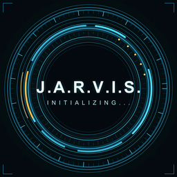

# Jarvis

Jarvis is a personal AI assistant with a voice-first HUD, built on
[LiveKit Agents for Python](https://github.com/livekit/agents) and
[LiveKit Cloud](https://cloud.livekit.io/). The Python agent does the thinking
and tool calling; the Flutter app in [`livekit_flutter_starter`](livekit_flutter_starter)
and the Next.js frontend in [`frontend`](frontend) are the clients.

The project includes:

- A [voice AI assistant](https://docs.livekit.io/agents/start/voice-ai/) with
  tools for the local PC, the web, and the device the app runs on.
- A speech-to-speech pipeline on Gemini 3.1 Flash Live through the Google
  plugin (`google.beta.realtime.RealtimeModel` in `src/agent.py`), so there are
  no separate STT and TTS stages.
- [Background voice cancellation](https://docs.livekit.io/transport/media/noise-cancellation/)
  through AI Coustics, and the [LiveKit turn detector](https://docs.livekit.io/agents/logic/turns/turn-detector/).
  Other models can be swapped in from the [model catalog](https://docs.livekit.io/agents/models/).
- **One assistant interface.** The clients connect to the cloud agent when
  possible and keep local device actions available when it is unreachable.
- **PC and phone access without a terminal.** Deploy the agent to LiveKit Cloud
  once, and the app connects on its own from any device.
- Session transcripts, traces, and recordings from LiveKit [Agent Observability](https://docs.livekit.io/testing/observability/).
- [Simulations](https://docs.livekit.io/testing/simulations/) that test full conversations with your agent, run in CI on every merge to `main`.
- A `Dockerfile` for [deploying to LiveKit Cloud](https://docs.livekit.io/deploy/agents/).

## Project layout

| Path | What it is |
|------|------------|
| `src/` | The Python agent: instructions, tools, and the entry point in `src/agent.py` |
| `livekit_flutter_starter/` | The Flutter client for Android, iOS, web, macOS, and Windows |
| `frontend/` | The Next.js web client |
| `scenarios.yaml` | Simulation scenarios run in CI |

## Deploying Jarvis to LiveKit Cloud

Deploying means no machine needs to keep a terminal open: LiveKit Cloud runs the
agent and the apps connect to it directly.

```console
lk cloud auth
lk agent create --secrets "GOOGLE_API_KEY=..." --region ap-south
```

LiveKit Cloud injects `LIVEKIT_URL`, `LIVEKIT_API_KEY`, and `LIVEKIT_API_SECRET`
into the deployed agent, so they do not belong in the secrets. Pass only your
model keys: `--secrets-file` with a file that contains just those keys also
works.

The dispatch name stays `my-agent`, matching `LIVEKIT_AGENT_NAME` in the
Flutter build configuration. Check the deployment with
`lk agent status` and follow it with `lk agent logs`.

For terminal-free access, host the Next.js app from `frontend` with its LiveKit
credentials and dispatch name configured. Build the Flutter app with
`LIVEKIT_TOKEN_ENDPOINT=https://<your-host>/api/token` and
`LIVEKIT_AGENT_NAME=my-agent` supplied as `--dart-define` values. Both clients
then get short-lived room tokens from that hosted endpoint; the Flutter package
does not contain a LiveKit API secret.

> [!NOTE]
> The cloud agent can still use tools that run on the device through RPC, but
> PC-only tools (local drives, a visible browser window) only work when the
> agent runs on that PC with `lk agent dev`.

## Build the apps

Flutter, with split APKs and obfuscation to keep the download small:

```console
cd livekit_flutter_starter
flutter pub get
flutter build apk --release --split-per-abi --obfuscate --split-debug-info=build/symbols
```

The Next.js web client:

```console
cd frontend
pnpm install
pnpm build
```

When the web client is hosted, set `LIVEKIT_URL`, `LIVEKIT_API_KEY`,
`LIVEKIT_API_SECRET`, and `AGENT_NAME` in the host's environment. The included
token route is unauthenticated, so it also requires `ALLOW_PUBLIC_TOKEN=true`;
add authentication before sharing the URL.

Regenerate every app icon from the master artwork:

```console
cd livekit_flutter_starter
python tool/generate_brand_assets.py
```

See the [Flutter README](livekit_flutter_starter/README.md) for the client
configuration, offline mode, token sources, signing, and size details.


## Using coding agents

This project works with coding agents like [Claude Code](https://claude.com/product/claude-code), [Cursor](https://www.cursor.com/), and [Codex](https://openai.com/codex/).

LiveKit offers both a CLI and an [MCP server](https://docs.livekit.io/reference/developer-tools/docs-mcp/) for browsing and searching its documentation. Search returns short excerpts, so fetch the full page to read the details:

```console
lk docs search "testing my agent"
lk docs get-page /testing/unit-tests
```

The project also includes an [`AGENTS.md`](AGENTS.md) file, so your coding agent follows LiveKit's best practices for workflows, handoffs, and testing, and tries its changes with the [agent debugger](https://docs.livekit.io/testing/debugger/).

For more guidance at each stage of the work, from building and debugging to testing and deploying, install LiveKit's [agent skills](https://docs.livekit.io/intro/coding-agents/#agent-skills). The CLI installs them for the coding agents on your machine and adds the Docs MCP server to their config. `lk agent init` offers to do this when it creates your project, or you can run it yourself:

```console
lk skills install
```

Run `lk skills update` to get the latest skills, and commit `skills-lock.json` along with them. See the [coding agents guide](https://docs.livekit.io/intro/coding-agents/) for more details.

## Dev setup

Install the [LiveKit CLI](https://docs.livekit.io/intro/basics/cli/), version 2.18.8 or later:

- **macOS:** `brew install livekit-cli`
- **Linux:** `curl -sSL https://get.livekit.io/cli | bash`
- **Windows:** `winget install LiveKit.LiveKitCLI`

Check your version with `lk --version`. To update an existing install, see [Update the CLI](https://docs.livekit.io/reference/developer-tools/livekit-cli/#updates).

Then install the Python dependencies into a virtual environment with [uv](https://docs.astral.sh/uv/):

```console
uv sync
```

Copy `.env.example` to `.env.local` and fill in the model keys, then have the CLI
write your project's URL and API keys into the same file:

```console
lk cloud auth
lk app env --write --destination .env.local
```

## Run the agent

The `lk agent console`, `lk agent dev`, and `lk agent debugger` commands run your agent on your own machine. To talk to it in your terminal:

```console
lk agent console
```

To connect it to LiveKit Cloud so a frontend, a phone call, or the [Agent Console](https://docs.livekit.io/testing/agent-console/) can reach it:

```console
lk agent dev
```

To let a coding agent or a script test it one text turn at a time, use the [agent debugger](https://docs.livekit.io/testing/debugger/). Each turn prints the agent's reply along with the tool calls and handoffs behind it:

```console
lk agent debugger start
lk agent debugger say "Hi, what can you do?"
lk agent debugger stop
```

In production, run the agent directly:

```console
uv run src/agent.py start
```

## Frontends and telephony

This project already includes the Flutter client and the Next.js web client. If
you want a different stack, pair the agent with a prebuilt frontend starter, or
add telephony:

| Platform | Link | Description |
|----------|----------|-------------|
| **Web** | [`livekit-examples/agent-starter-react`](https://github.com/livekit-examples/agent-starter-react) | Web voice AI assistant with React & Next.js |
| **iOS/macOS** | [`livekit-examples/agent-starter-swift`](https://github.com/livekit-examples/agent-starter-swift) | Native iOS, macOS, and visionOS voice AI assistant |
| **Flutter** | [`livekit-examples/agent-starter-flutter`](https://github.com/livekit-examples/agent-starter-flutter) | Cross-platform voice AI assistant app |
| **React Native** | [`livekit-examples/voice-assistant-react-native`](https://github.com/livekit-examples/voice-assistant-react-native) | Native mobile app with React Native & Expo |
| **Android** | [`livekit-examples/agent-starter-android`](https://github.com/livekit-examples/agent-starter-android) | Native Android app with Kotlin & Jetpack Compose |
| **Web Embed** | [`livekit-examples/agent-starter-embed`](https://github.com/livekit-examples/agent-starter-embed) | Voice AI widget for any website |
| **Telephony** | [Documentation](https://docs.livekit.io/telephony/) | Add inbound or outbound calling to your agent |

For more options, see the [frontend guide](https://docs.livekit.io/frontends/).

## Testing and debugging

Simulations run full multi-turn conversations between a simulated user and your agent on LiveKit Cloud, then judge each transcript. The scenarios live in [`scenarios.yaml`](scenarios.yaml). Run them locally with the CLI:

```console
lk agent simulate text --scenarios scenarios.yaml
```

The `Simulations` workflow in [`.github/workflows/simulations.yml`](.github/workflows/simulations.yml) runs the same file on every merge to `main`, and on demand from the Actions tab. It doesn't run on every pull request push because each run uses real inference. See the [simulations guide](https://docs.livekit.io/testing/simulations/) for how to write scenarios and read results.

To check a change turn by turn without a live session, use the [agent debugger](https://docs.livekit.io/testing/debugger/) shown in [Run the agent](#run-the-agent).

To debug a running agent, open it in the [Agent Console](https://docs.livekit.io/testing/agent-console/). It shows events, tool calls, and model timing as you talk to the agent. To stream logs from a deployed agent, run `lk agent logs`.

## Using this template for your own project

After you create your own project from this template:

- **Commit `uv.lock`.** The template doesn't track it, but your project should, for reproducible builds. If you deploy to LiveKit Cloud, commit `livekit.toml` too.
- **Add repository secrets.** Add `LIVEKIT_URL`, `LIVEKIT_API_KEY`, and `LIVEKIT_API_SECRET` as [repository secrets](https://docs.github.com/en/actions/how-tos/writing-workflows/choosing-what-your-workflow-does/using-secrets-in-github-actions) so the simulations can run in CI.

## Deploying to production

To deploy the agent to LiveKit Cloud or another environment with the included `Dockerfile`, see the [deployment guide](https://docs.livekit.io/deploy/agents/).

## Self-hosted LiveKit

You can self-host LiveKit instead of using LiveKit Cloud. See the [self-hosting guide](https://docs.livekit.io/transport/self-hosting/local/). If you self-host, use [model plugins](https://docs.livekit.io/agents/models/#plugins) instead of LiveKit Inference, and remove the [LiveKit Cloud noise cancellation](https://docs.livekit.io/transport/media/noise-cancellation/) plugin.

## License

This project is licensed under the MIT License. See [LICENSE](LICENSE) for details.
