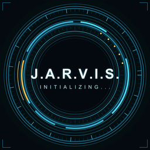

# Jarvis

Jarvis is a personal AI assistant with a voice-first HUD. It runs on LiveKit
Agents: a Python agent does the thinking and tool calling, and the Flutter app
is the client you talk to on Android, iOS, web, macOS and Windows.

There is also a browser frontend in [`../frontend`](../frontend) that serves the
same HUD on the web.

## Features

- **Voice, text and video.** Talk to Jarvis, type to it, or share the camera so
  it can see what you show it.
- **One assistant experience.** Jarvis reconnects in the background and keeps
  local device actions available on the same screen when the cloud agent cannot
  be reached. The current local handler supports flashlight, volume, media,
  apps, websites, time and date; open-ended AI answers still need the cloud.
- **Device actions.** The agent can call tools that are executed on the phone:
  opening apps, playing local media, sending WhatsApp messages, torch, volume,
  and opening Settings.
- **No terminal needed.** Once the agent is deployed to LiveKit Cloud, the app
  connects on its own from PC or phone.

## Configure the app

The app gets short-lived room tokens from the hosted Next.js endpoint. Pass its
public HTTPS URL and the deployed agent name at build or run time:

```bash
flutter run \
  --dart-define=LIVEKIT_TOKEN_ENDPOINT=https://<your-host>/api/token \
  --dart-define=LIVEKIT_AGENT_NAME=my-agent
```

Configure `LIVEKIT_URL`, `LIVEKIT_API_KEY`, `LIVEKIT_API_SECRET`, `AGENT_NAME`,
and `ALLOW_PUBLIC_TOKEN=true` on the host as described in the
[web frontend guide](../frontend/README.md). Keep the API secret on the server;
the Flutter app only contains the public endpoint URL. The agent name must match
the deployed agent's dispatch name.

## Run it

```bash
flutter pub get
flutter run
```

To run against a local agent, see the [agent README](../README.md) and start it
with `lk agent dev`.

## Local use without a connection

The app keeps the same HUD on screen and retries the cloud connection in the
background. The built-in local actions are matched by
[`lib/support/offline_commands.dart`](lib/support/offline_commands.dart) and the
device speech is handled by [`lib/support/offline_voice.dart`](lib/support/offline_voice.dart):

- **Android** uses `SpeechRecognizer` with `EXTRA_PREFER_OFFLINE` and the system
  `TextToSpeech` engine, through the existing `jarvis/device` channel. No extra
  packages are added.
- **Every platform** can type an offline command. Offline speech and native
  device actions are currently available on Android.
- Say or type `help` to hear the local actions available on this device.

The current app does not include an on-device language model, so it cannot hold
an open-ended AI conversation with the internet disconnected. It can still hear
and speak supported local actions without switching to a separate screen.

For reliable offline recognition, install the offline speech language for your
locale in Android Settings. The app opens Settings for you if the engine reports
it is missing.

## Small release builds

Release builds enable R8 minification and resource shrinking. Build split APKs
so each phone downloads only the ABI it needs:

```bash
flutter build apk --release --split-per-abi --obfuscate --split-debug-info=build/symbols \
  --dart-define=LIVEKIT_TOKEN_ENDPOINT=https://<your-host>/api/token \
  --dart-define=LIVEKIT_AGENT_NAME=my-agent
```

Keep the `build/symbols` folder: it is required to read stack traces from an
obfuscated build. The ProGuard keep rules live in
`android/app/proguard-rules.pro`; they protect Flutter, WebRTC and the plugins
that are reached through reflection.

## App icon

The launcher icon and every generated size come from one master image:

```bash
python tool/generate_brand_assets.py
```

It writes the Android mipmaps, iOS/macOS icon sets, web/PWA icons, the Windows
`.ico`, the Next.js icon, the README artwork, and `assets/jarvis_logo.png` used
on the welcome screen. To change the branding, replace the master image path at
the top of the script, or overwrite `assets/jarvis_logo.png` and re-run it.

## Testing

```bash
flutter test
flutter analyze
```

`test/offline_commands_test.dart` covers the offline matcher, and
`test/widget_test.dart` covers the HUD widgets without starting a LiveKit
session.

## Notes

- Video and screen share may need a physical device rather than an emulator.
- iOS builds need signing certificates configured in Xcode.
- The app is dark-only by design; both theme slots point at the same HUD palette.
